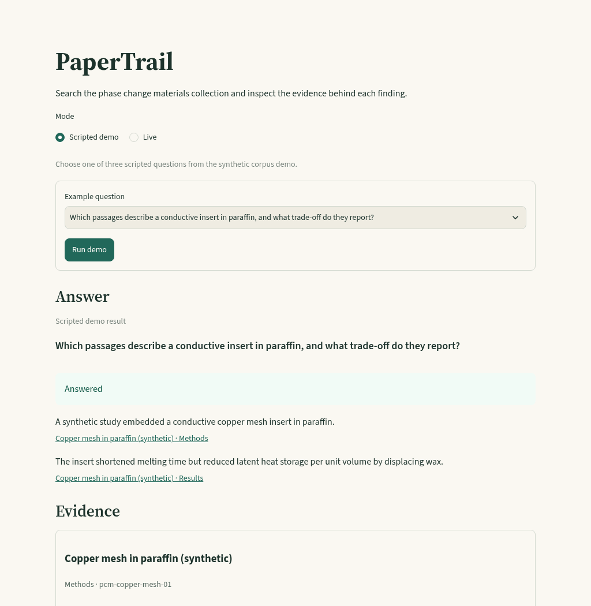
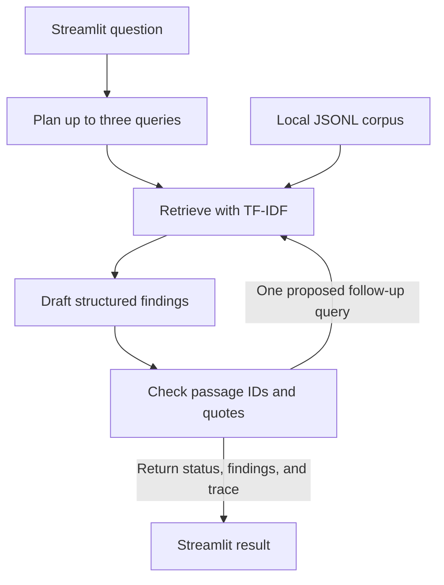

# PaperTrail

PaperTrail is a local research evidence prototype. It searches a small
collection about heat transfer in phase change materials and returns findings
with quotes you can trace to the source passage. It also shows which searches
ran and which parts of the question remain unresolved.

## Run the demo

Install uv and run these commands from the project root. The project selects
Python 3.12. [uv installation guide](https://docs.astral.sh/uv/getting-started/installation/)

```sh
uv sync --locked
uv run streamlit run app.py
```

**Scripted demo** opens with an answered copper mesh question and runs without
an API key. Follow a citation to its evidence card and expand **View full
passage** to read the source. Run the graphite example to see a partial answer
and one follow-up search, or run the Europa example to see insufficient
evidence. **Run details** shows the actual queries, passage counts, model calls,
retries, and time.



For free-text questions, set `OPENAI_API_KEY` before launching the app and
select **Live**. [Live configuration](docs/PaperTrail_Local_Demo.md#enable-live-mode)

## Architecture



LangGraph handles the workflow, and Pydantic validates the structured outputs.
Each draft receives up to six passages. The graph allows one proposed follow-up
search for an evidence gap or a failed citation and up to three model calls
per run. Citation checks confirm that a quote occurs in a retrieved passage.
Assessing whether the passage supports the claim requires human review.

## Evaluation

The runner compares a single search of the original question plus one draft
with the graph. Both paths share the corpus, retriever, model, first-pass
context cap, and citation checks.

```sh
uv run --locked python scripts/run_eval.py
```

In the scripted paraphrase case, the single-query baseline missed both
labeled passages. The graph retrieved one on its first search and recovered
the second with a follow-up. The recorded run covers four scripted fixture
cases. [Benchmark results](docs/PaperTrail_Benchmark.md) ·
[Evaluation setup and human review template](docs/PaperTrail_Evaluation.md)

## Corpus and checks

The bundled corpus contains six synthetic passages and stable source metadata.
The demo links to local evidence cards for those passages. [Corpus provenance](docs/PaperTrail_Corpus_Provenance.md)

```sh
uv run --locked --offline ruff check .
uv run --locked --offline pytest -q
```

CI installs dependencies from the lockfile and then runs both checks in a
network-isolated step. [GitHub Actions workflow](.github/workflows/ci.yml)
