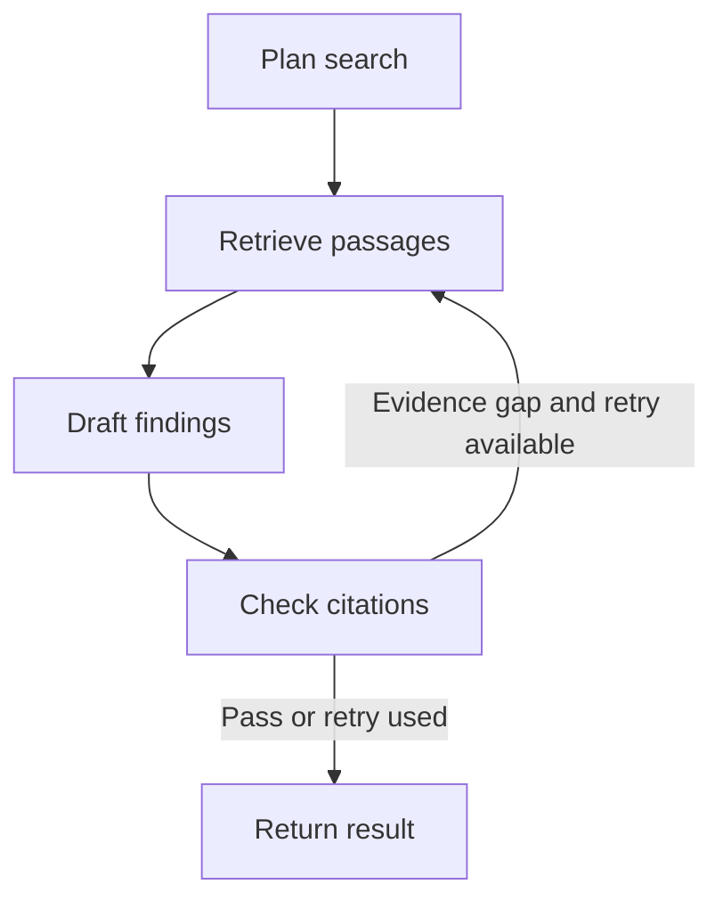

# PaperTrail: a research evidence agent

**Project brief · Portfolio MVP · Python and LangGraph**  
Suggested repository: `papertrail-agent`

> Ask a technical question. Get an answer with passages you can inspect, or a clear explanation of what the collection does not establish.

## 1. What to build

Build a small web app for searching a curated set of technical documents. A researcher enters a question, sees a short answer broken into findings, and can expand each finding to read the cited passage and open its source. A separate panel shows which searches the agent tried and whether it had to look again.

Start with **one topic: heat transfer in phase change materials**. This gives you a subject you can discuss and evaluate credibly. It also shows the same retrieval, reasoning and citation checks used in document-heavy fields such as patent research, with a corpus you can keep small enough to judge by hand.

**Example question:** “Which documents describe using a conductive insert in a phase change material, and what trade-off do they report?”  
**Example result:** One passage describes an insert; another supports a trade-off. If the collection contains only the first passage, show the supported finding and mark the trade-off as unresolved. If it contains neither, return “This collection does not provide enough evidence.”

## 2. Scope

| In the first release | Save for later |
|---|---|
| One question at a time, one curated collection, simple answer and evidence cards | Chat history, PDF uploads, OCR, live web crawling |
| Local full-text retrieval, a LangGraph workflow, one LLM provider | Embeddings, a vector database, or a second model |
| A capped second search when evidence is missing or a citation fails | Multiple independent agents, long-running tasks |
| A local Streamlit demo with example questions that work without credentials | Public hosting, authentication, Kubernetes |
| A small labeled evaluation set and a plain retrieval baseline | A large benchmark, production monitoring |

Start with synthetic fixtures clearly marked as such. For the portfolio release, aim for **12–20 searchable passages from 6–10 documents** on the same subject, where the source terms permit redistribution. Keep a manifest with title, URL or DOI, source terms, section or page, and stable passage ID. Use exact, traceable excerpts. If a document’s text cannot be shared under its terms, leave it out of the distributed corpus. Label synthetic passages separately so nobody mistakes them for published findings.

## 3. How the workflow works

The model makes two decisions: how to search for evidence and how to turn the retrieved passages into findings. Python owns the limits, validation and final routing.

| Step | What happens |
|---|---|
| **Plan** | The model breaks the question into at most three short search queries and identifies what evidence would answer it. |
| **Retrieve** | A read-only search function ranks local passages. Deduplicate by passage ID and cap each pass at six passages. Keep the source metadata alongside each passage. |
| **Draft** | The model returns structured findings. Each finding contains a short claim, a passage ID and a verbatim supporting quote. It also reports parts of the question it could not answer. |
| **Check** | Python checks that every cited ID was retrieved for this question and that the quoted text appears in that passage after normalising whitespace. Bibliographic metadata and links come from the manifest, never from model output. This confirms the citation exists; it does **not** prove the quote supports the claim. Evaluate that separately. |
| **Repair or stop** | If citations fail or an evidence gap remains, the draft can suggest one follow-up query. Run one more search and draft only. Drop findings that still fail citation checks, then return `answered`, `partial`, or `insufficient_evidence`. Surface provider failures as `error`, separately from a lack of evidence. |

Store the question, current queries, retrieved IDs, draft, validation failures, retry count and node timings in graph state. Let Python enforce one retry and at most three model calls per question: plan, draft, optional redraft. Apply provider timeouts and cap displayed evidence. Treat excerpts as untrusted text: a passage cannot change graph instructions or trigger an external tool. The only tool in the MVP searches the local corpus.

## 4. Stack

| Layer | Tool | Why |
|---|---|---|
| Workflow | Python 3.12, LangGraph `StateGraph`, Pydantic | Explicit state and routing; validate structured inputs and outputs. |
| Model | One provider adapter and one scripted fake | Get realistic results in live mode and deterministic runs in tests. |
| Retrieval | scikit-learn TF-IDF and cosine similarity; JSONL corpus | A transparent baseline for a small, fixed collection. No database to run. |
| Interface | Streamlit | Build a usable dashboard and inspect citations without maintaining a separate frontend. |
| Engineering | Git, uv, Ruff, pytest, GitHub Actions | Reproducible setup, offline checks and a clean clone-to-demo path. |

**Interface:** Give users a question box, three example questions, evidence cards and a collapsible run summary showing search terms, source count, retry and elapsed time. Use three scripted cases in offline mode (answered, partial, insufficient evidence). Clearly label offline results and lock offline mode to those cases; live mode accepts free text and uses the configured LLM. Do not send private documents or secrets to the model.

## 5. How to show it works

Compare **direct retrieval + one draft** with **the graph** on the same held-out questions. Use the same corpus, retrieval function, model, first-pass context cap and citation checker. The baseline searches the original question once; the graph can plan and retry. Report the extra calls and time alongside any quality gains.

| Metric | What to report |
|---|---|
| Evidence retrieval | Recall@6 on answerable questions: fraction of labeled relevant passages in the first six results, plus whether a retry found missing evidence. |
| Claim support | Share of returned claims that a human reviewer judges supported by the cited text. Report counts as well as percentages. Exact quote matching alone is not enough. |
| Abstention | How often the app correctly returned insufficient evidence on unanswerable questions. Report partial cases and false abstentions on answerable questions separately. |
| Cost and latency | Median elapsed time, model calls per question and token counts if available. Only report currency costs if you can state the rate and calculation used. |

Include a table with actual measurements and one example where the graph helped or did not. A small mixed result is still useful: explain which questions benefit from the extra search and when direct retrieval is adequate. Keep scripted CI checks separate from live model evaluation.

### Portfolio deliverables

A screenshot or short GIF, a readable architecture diagram, a key-free local demo, a benchmark report with limitations, and a short case study: **what failed, what you changed, and what happened after the change**. Describe the project as a portfolio prototype unless you later operate it for real users.

### Technical references

- [LangGraph Graph API](https://docs.langchain.com/oss/python/langgraph/graph-api)
- [scikit-learn TF-IDF vectorizer](https://scikit-learn.org/stable/modules/generated/sklearn.feature_extraction.text.TfidfVectorizer.html)
- [Running a Streamlit app](https://docs.streamlit.io/develop/concepts/architecture/run-your-app)
